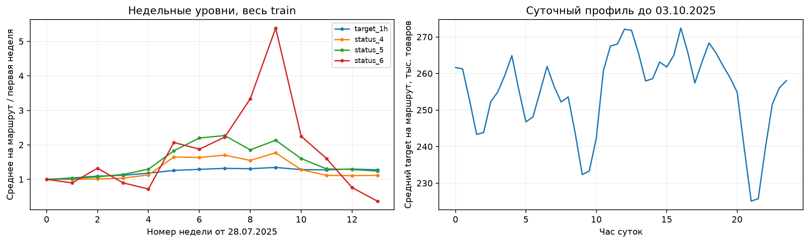
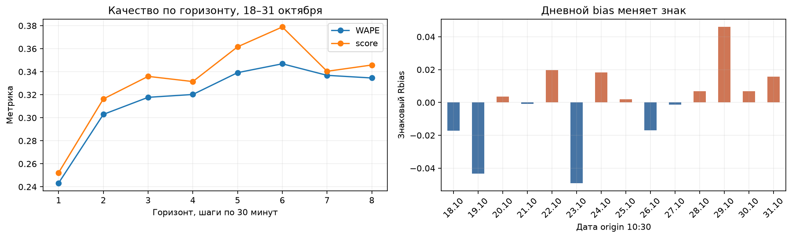
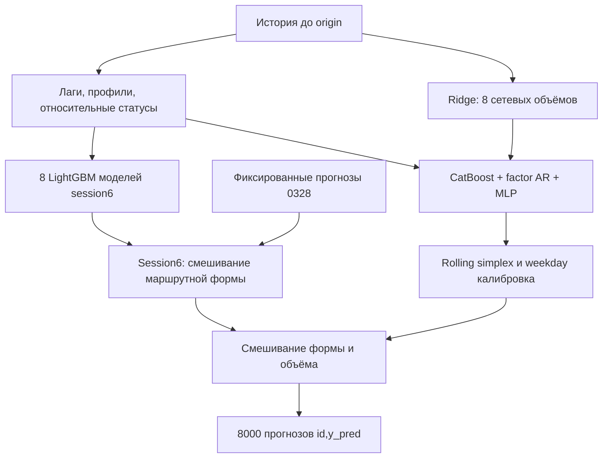

# Прогноз отгрузок по маршрутам склада

Проект хакатона: прогноз `target_1h` для 1000 маршрутов на следующие 8 шагов по 30 минут. Решение объединяет временные признаки, LightGBM, CatBoost, динамические факторы, нейросеть маршрутных долей и калибровку сетевого объёма.

**Главный артефакт:** [выполненный финальный ноутбук](notebooks/final_solution.ipynb). Он доступен для просмотра на GitHub вместе с таблицами, графиками и результатом полного inference.

## Результат

Сравнение на едином локальном периоде **18–31 октября 2025**, каждый день origin 10:30: 14 дат × 1000 маршрутов × 8 горизонтов = 112000 прогнозов.

| Модель | WAPE | Знаковый Rbias | WAPE + abs(Rbias) | Средний дневной score |
|---|---:|---:|---:|---:|
| Persistence | 0.466002310 | +0.004382362 | 0.470384672 | — |
| Сезонный лаг 1 день | 0.465138831 | +0.002812607 | 0.467951437 | — |
| Сезонный лаг 7 дней | 0.468820023 | +0.004577726 | 0.473397749 | — |
| Исходный ноутбук 0328 | 0.320090299 | −0.001363524 | 0.321453824 | 0.338300893 |
| Session6 | 0.317826676 | −0.001363524 | 0.319190200 | 0.336038662 |
| Итерация 31: лучший pooled score | 0.317116297 | −0.000146206 | **0.317262503** | 0.335080516 |
| **Финальная итерация 39** | **0.317234709** | **−0.001091005** | **0.318325715** | **0.335009164** |

Финальный вариант улучшил WAPE относительно session6 в **12 из 14 дней** и в обе недели. Он выбран по средней дневной метрике среди кандидатов, прошедших дополнительные проверки устойчивости. Усреднение дневных метрик и pooled-метрика — разные величины: смещения разных дней могут компенсироваться при общем суммировании.

**Public:** исходный результат отображался как **0.328**, session6 и финальный вариант — как **0.326**. По сообщению автора, финальная отправка лучше session6 на **0.0004** при неокруглённом сравнении. Точные абсолютные значения Public не сохранены; значение `0.3256` из этих сведений не выводится. Цель **Public <0.322 не достигнута**. Источник Public — сообщение автора, а не автоматическая выгрузка leaderboard. Подробности: [public_result.json](reports/public_result.json).

Канонический отправленный файл — [submission_final.csv](submissions/submission_final.csv), 8000 строк, столбцы `id,y_pred`


## Данные и смысл задачи

В `train_solo_track.parquet` **4630000 строк**, **1000 route_id**, **4630 моментов времени** с шагом 30 минут: с **28.07.2025 00:00** по **01.11.2025 10:30**. Последний момент — origin финального прогноза; тест охватывает **11:00–14:30** того же дня.

| Поле | Содержание |
|---|---|
| `route_id` | Маршрут склада |
| `timestamp` | Временная отметка с шагом 30 минут |
| `status_1..3` | Количества товаров маршрута, прошедших этапы на текущем складе за последние 30 минут |
| `status_4..6` | Количества направляющихся на текущий склад товаров, прошедших этапы на предыдущем складе за последние 30 минут |
| `target_1h` | Объём отгрузки маршрута за последний час |

Статусы — **оконные счётчики**, а не подтверждённые остатки. Один товар может встречаться в разных статусах и строках; точные этапы, дедупликация и длительность переходов неизвестны. Соседние часовые target перекрываются: их простая разность не восстанавливает получасовую отгрузку, сумма восьми target не равна числу уникальных товаров за четыре часа.

Официальная целевая метрика в использованном коде относится к **target_1h**, статусы отдельно не предсказываются. Проверенный формат submission: **8000 уникальных id** в исходном порядке теста, конечные неотрицательные `y_pred`.

## EDA: наблюдения и рабочие гипотезы



1. **Регулярная полная панель.** Не обнаружены пропуски значений, дубликаты `(route_id,timestamp)`, отрицательные значения и пропущенные получасовые шаги. Нулевой target встречается в **1.5084%** строк. Это проверяется заново в ноутбуке.
2. **Сезонность полезна, но простых лагов недостаточно.** Persistence и сезонные baseline дают локальный score около 0.47. Суточный профиль исследован на train до 03.10.2025; статистики не подгонялись на последующих оценочных датах.
3. **Статусы 4–6 меняют уровень во времени.** Недельные уровни по всему train показаны как описательный анализ. Это мотивировало нормализацию каждого статуса на собственное прошлое среднее и ограничение веса абсолютных уровней. Дрейф не доказывает физическую природу счётчика.
4. **`status_6 > status_4` встречается в 0.1254% строк.** Условие вложенности статусов не вводилось; нарушение такого условия само по себе не означает ошибку.
5. **Маршрутный масштаб неоднороден.** На обучающем участке до 03.10.2025 первые 100 маршрутов по объёму составляют **17.432%** суммы target. Масштабирование по доступному прошлому помогает объединить маршруты в общей модели.
6. **Bias меняет знак по дням.** Малое суммарное смещение может скрывать заметные дневные ошибки. Поэтому окончательный выбор дополнительно учитывает средний дневной score и улучшение обеих недель.

Исходные агрегаты и проверки: [eda_summary.json](reports/eda_summary.json), [недельные уровни](reports/eda_weekly_levels.csv), [субботние срезы дрейфа](reports/drift_saturdays.csv). Корреляции и статистические факторы рассматриваются как признаки, без причинных выводов о движении товаров.

## Метрика и знак Rbias

Для всех оцениваемых пар «маршрут × горизонт × origin»:

```text
WAPE  = sum(abs(prediction - y)) / sum(y)
Rbias = sum(prediction - y) / sum(y)
score = WAPE + abs(Rbias)
```

**Отрицательный Rbias означает занижение**, положительный — завышение. Расчёт ведётся в float64 с общим знаменателем; это не среднее маршрутных процентных ошибок. При нулевом суммарном target метрика не определена, проверка останавливает расчёт. Все значения в таблицах — доли, например `0.326` соответствует `32.6%` комбинированной метрики.

Гипотеза о глобальном множителе проверена через `scipy.optimize`: оптимизация агрегированного уровня без учёта даты не дала устойчивого улучшения. Более полезным оказалось разделить прогноз **долей маршрутов** и **сетевого объёма**, подбирая их смешивание хронологически.

## Временная валидация и защита от утечек

Новые модели проверялись на 6 rolling-фолдах: **20.09, 27.09, 04.10, 11.10, 18.10, 25.10.2025**, origin каждого фолда 10:30. Модель обучается один раз в начале недели и прогнозирует 7 последовательных ежедневных origin. На каждом следующем ежедневном origin ей доступна фактическая история, уже появившаяся к этому моменту.

Последние train labels раньше **origin −4 часа**. Масштабы, SVD, нормализации нейросети и обучаемые преобразования fit только на train-части соответствующего фолда. Лаги и rolling вычисляются внутри маршрута из текущей доступной и прошлой истории; будущие target используются как labels. Профили обращаются к историческим значениям тех же будущих слотов, а не к неизвестному будущему.

Для деревьев и MLP использовались пять утренних origin в день **09:30–11:30**, для структурных моделей — все получасовые шаги. Начальная история не менее 7 дней. Прогноз сети Ridge рассчитывался причинно для каждого дня. Веса rolling-ансамбля на каждом фолде обучались только по более ранним OOF-прогнозам.

Внешние веса смешивания с session6 подбирались **11–17 октября**. Итоговое сравнение — **18–31 октября**, 112000 строк. Этот участок многократно использовался при разработке 40 попыток и **не является независимым слепым тестом**. Более ранний поиск моделей базового решения также проводился отдельно; число 40 относится к описанной серии оптимизации, а не ко всей истории проекта.

Аудит сверил **10080000 labels** у 30 новых кандидатов, текущий ноутбук независимо проверяет **336000** labels сохранённого rolling-прогона по исходному train. Одна технически неудачная попытка 8 учтена в лимите; все 30 дополнительных попыток валидны. Зафиксировано 13 чекпоинтов при новых минимумах. См. [аудит экспериментов](reports/experiment_audit.json).



## Признаки

| Семейство | Признаки и смысл |
|---|---|
| Короткая история target | Лаги 0–8, 12, 24, 48, 96, 336 шагов; средние 4/12/48 и стандартные отклонения 4/12. Нормализация на прошлое среднее 48 шагов маршрута |
| Статусы | Текущие/прошлые значения, средние 4/12, изменения за 2/4 шага; отношения к уровню target и собственному прошлому среднему 48 |
| Длинная история session6 | Статусные лаги 4/8/12/24/48/96, средние 48/336, короткий уровень относительно суточного и суточный относительно недельного |
| Историческая сезонность | Значения слота будущего горизонта 1/2/3/7/14/21/28 дней назад; соседние исторические получасовые слоты; усреднённые дневные и недельные профили |
| Сеть маршрутов | Доступные суммы текущих target/статусов, их собственные прошлые уровни и изменения; доля маршрута в текущем сетевом объёме |
| Календарь | Горизонт, день недели, время origin и будущего слота, синус/косинус суток и недели |
| Структурные | Train-only SVD-состояния, нагрузки и произведения; Fourier-оценка календарного уровня, локальная AR-поправка |
| Нейросеть | Нормализованные лог-лаги target, собственные относительные статусы, короткие средние, календарь и embedding маршрута |

Здесь 48 шагов — сутки,336 — неделя. Включение текущего известного значения на origin допустимо; неизвестные значения после origin не используются. Сетевые суммы вычисляются по одновременно доступным маршрутам, без доступа к будущим датам.

## Как устроен финальный прогноз



**Session6.** Доли маршрутов из 8 LightGBM моделей по горизонтам смешиваются с исходным прогнозом 0328 с весом **0.4997259022**, сохраняя исходные суммы каждого горизонта. Модели LightGBM имеют длинные и устойчивые относительные статусные признаки. Эти модели были сохранены после обучения до 04.10 с early stopping на 04–10.10; новый fit на финальную дату не подменяет их.

**Сетевой объём.** Фиксированная политика Ridge с 8 выходами, окном 56 дней, полураспадом весов 14 дней и дополнительным весом близости времени суток (`sigma=8` слотов), `alpha=200`. Прогнозы маршрутных компонентов нормируются на этот объём.

**Новые маршрутные компоненты.** CatBoost обучается на относительной целевой величине/долях с весами объёма; factor-AR использует train-only SVD; нейросеть представляет собой MLP с embedding8, шириной 128 и softmax по 1000 маршрутам каждого горизонта. У сильного варианта 31 базовые лог-доли построены от текущего суточного уровня;18 эпох, окно 56 дней.

**Ансамбль 39.** Веса выбирались регуляризованной оптимизацией на более ранних rolling-OOF; финальный рецепт содержит:

| Компонент | Краткое описание | Вес |
|---|---|---:|
| 25 | CatBoost + факторы ранга 8 | 0.150704 |
| 18 | Динамические факторы ранга 16 + локальные статусы | 0.064384 |
| 22 | Fourier + статусы; нулевой итоговый вес | 0.000000 |
| 31 | MLP долей с базой суточного уровня | 0.315057 |
| 12 | CatBoost долей, MAE | 0.097095 |
| 13 | CatBoost долей, Lq1.1, более короткое окно | 0.101842 |
| 14 | CatBoost лог-долей | 0.143576 |
| 27 | CatBoost + Fourier + route_id | 0.127342 |

Рецепт сохранён полностью, включая нулевой компонент 22, чтобы не менять порядок операций исходного inference. Применяются отдельные множители объёма по 8 горизонтам. Внешний вес маршрутной формы — **0.3443801631**, сетевого объёма — **0.2050896225**. Полная точность в [final_ensemble.json](bundle/results/iteration_39/final_ensemble.json) и [outer.json](bundle/results/iteration_39/outer.json).

Подбор формы минимизировал средний дневной WAPE с регуляризацией `0.001 * weight²`; подбор объёма — средний дневной score с `0.002 * weight²`. Финальный критерий выбора дополнительно требует улучшения pooled WAPE/score, обеих недель и минимум 9 из 14 дней относительно session6.

## Исследования и гипотезы

Полный журнал: [CSV](reports/experiment_history.csv), [JSON](reports/experiment_history.json). В нём сохранены 40 попыток, метрики и статус; результаты 30 дополнительных кандидатов с проверками устойчивости — в [comparison.csv](reports/comparison.csv).

| Попытки | Гипотеза | Что наблюдали |
|---|---|---|
| 1 | Глобальный multiplier через scipy.optimize устранит bias | Локальный score около 0.33321: множитель недостаточно устойчив между датами |
| 2–5 | Остаточная модель и нормализация статусов | Последовательное улучшение до 0.3213893; target-only вариант оказался полезным контролем |
| 6 | Улучшить распределение по маршрутам, сохранить объём 0328 | Score0.3191902; подтверждённый Public 0.326 |
| 7–10 | Моделировать сетевой объём причинно | Ridge-политика 9 дала 0.3180184; попытка 8 технически завершилась неудачей |
| 11–15 | Новые CatBoost по долям, лог-шкалы, функции потерь | До 0.3178309; выигрыш зависел от временного окна и горизонта |
| 16–24 | Динамические факторы, Fourier и AR | Самостоятельный вклад ограничен; часть внешних весов обнулилась; факторы полезны как признаки |
| 25–27 | Структурные признаки внутри деревьев | 25: 0.3177830;27: 0.3177369; оба вошли в ансамбль |
| 28–33 | MLP, разные базы долей, embedding, окно и loss | Лучший pooled вариант 31: 0.3172625; база суточного уровня сильнее профильных вариантов |
| 34–37 | Rolling-ансамбли, simplex, горизонты и дни недели | Небольшие устойчивые улучшения формы; единый усредняющий ансамбль слабее оптимизированного |
| 38–40 | Калибровка объёма по недавним дням/дню недели, сохранение объёмаsession6 | Вариант 39 лучший по допустимой средней дневной метрике; выбран для финальной отправки |

Следствие исследования: прогноз маршрутной формы оказался устойчивее агрессивного глобального исправления уровня. Небольшой локальный выигрыш частично подтвердился на Public, но перенос абсолютного значения локального score на leaderboard оказался неверным ожиданием. Это наблюдение конкретной серии, а не универсальный вывод о всех складах.

## Структура репозитория

```text
notebooks/final_solution.ipynb   выполненный отчёт: EDA → метрики → полный inference
bundle/predict_final30.py       сборка исходного финального прогноза
bundle/code/                   признаки и классы деревьев, факторов, MLP
bundle/baseline_session6/       исходный CSV 0328, код и рецепт session6
bundle/results/                конфиги, внешние веса и рецепт ансамбля
bundle/network_policy/         аудит причинного прогноза сетевого объёма
reports/                       EDA, история, метрики по дням/неделям/горизонтам, SHA-256
figures/                       графики из серверного выполнения
submissions/submission_final.csv канонический отправленный файл
scripts/                       загрузка/проверка весов и воспроизведение
data/                          исходные parquet, игнорируются Git
artifacts/                     кэши, архив и новый CSV, игнорируются Git
```

## Воспроизведение на сервере

Проверено на Linux, Python 3.14, A10 для нейросети и CPU для остальных моделей. Для полного inference рекомендуется сервер с **16–32ГБ RAM**; это практический ориентир, не измеренный минимальный порог. Для чтения сохранённого ноутбука ресурсы не требуются. GPU ускоряет нейросеть и воспроизводит исходную платформу; CPU поддерживается.

После клонирования репозитория выполните из его корня:

```bash
python3.14 -m venv .venv
source .venv/bin/activate
python -m pip install -r requirements.txt
python scripts/artifacts.py fetch
python scripts/artifacts.py verify
```

Если архив уже скачан, вместо `fetch` используйте:

```bash
python scripts/artifacts.py fetch --archive /path/to/rwb-final-artifacts.tar.gz
```

Поместите исходные конкурсные `train_solo_track.parquet` и `test_solo_track.parquet` в `data/` либо укажите их каталог. Запуск **без обучения**:

```bash
export RWB_DATA_DIR=/path/to/competition-data
python scripts/predict.py --device cpu
```

Для сервера с подходящим CUDA PyTorch:

```bash
export RWB_NEURAL_DEVICE=cuda
python scripts/execute_notebook.py
```

`execute_notebook.py` запускает все ячейки сверху вниз текущим Python во временном ядре и сохраняет успешно выполненный notebook. При необходимости установите официальную сборку PyTorch для своей CUDA; если библиотека размещена в отдельном каталоге, поддерживается необязательная переменная `RWB_TORCH_PATH`. Пути и доступ к серверу в проекте не зашиты.

Новый CSV записывается в `artifacts/submission_reproduced.csv`. Исходный отправленный файл сохраняется отдельно. Проверяются SHA-256 входных данных и всех весов, форма 8000×2, порядок/уникальность id, конечность и неотрицательность прогноза, близость к каноническому CSV. Загрузка pickle/joblib/PT предполагает доверие к архиву этого проекта; SHA-256 сверяется до загрузки моделей.

## Что именно воспроизводится

Ноутбук **реально выполняет полный финальный inference из всех сохранённых весов**. EDA структуры train и проверка 336000 labels пересчитываются. Валидационные прогнозы 40 экспериментов и fit моделей повторно не запускаются: используются сохранённые rolling-предсказания и журнал. Это позволяет изучать исследование без повторения дорогого поиска.

Веса привязаны к версиям библиотек; для моделей sklearn/joblib требуется совместимое окружение. FP32 нейросеть на CPU и GPU даёт небольшие численные отличия. Проверка допускает `rtol=1e-7, atol=0.1`; на исходном GPU прежде получена максимальная ошибка около`9.3e-10`, при независимом CPU-воспроизведении — около`0.0385` единицы на отдельном прогнозе, относительная L1-ошибка порядка`7e-9`. Фактические значения нового серверного запуска сохранены в [notebook_execution.json](reports/notebook_execution.json).

**Граница воспроизводимости:** session6 содержит фиксированные предсказания 0328 только для конкурсных 8000 id. Код проверяет исходные данные по хешам. Это воспроизводимый конкурсный артефакт для данной даты, а не готовый универсальный сервис для любого нового склада/дня. Для развёртывания на новых датах потребуется исходная обучаемая модель 0328 либо замена этой опоры и новая временная проверка.

Дополнительные ограничения:14 дней итогового сравнения, многократное использование holdout при выборе гипотез, дрейф статусов, неизвестные детали учёта товаров и различие распределений локальной/Public выборки. Возможные дальнейшие направления — больше временных окон и честный новый holdout, проверка устойчивости к дрейфу и полный train pipeline для новых origin; новые эксперименты в этот артефакт не добавлялись.
